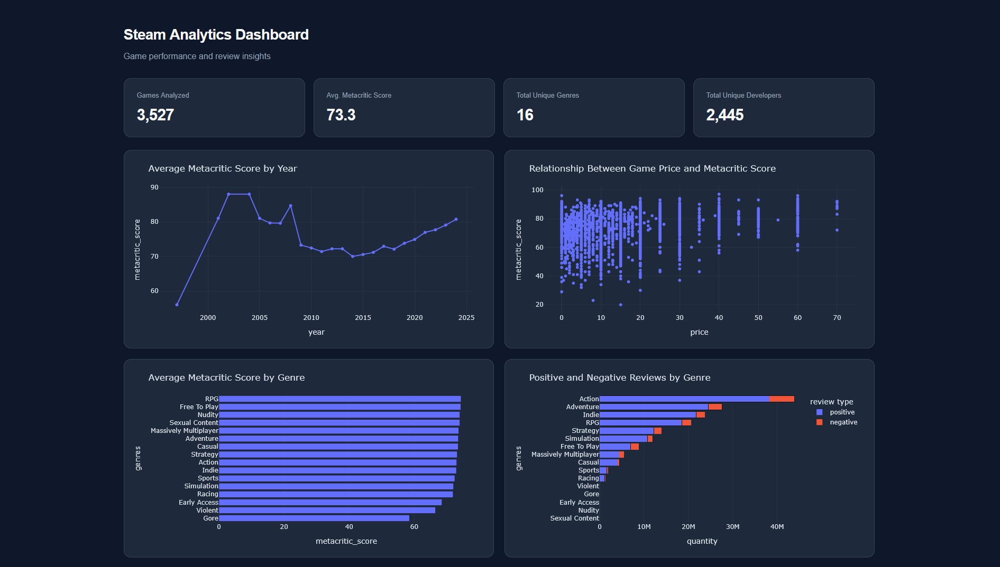

# Academic Project with Python & Plotly

An interactive data visualization dashboard built with **Python, Pandas, and Plotly** to explore Steam Metacritic scores, game performance, pricing, and player reviews.

This project was developed as part of the **Data Visualization** course at the **Pontifical Catholic University of Rio Grande do Sul (PUCRS)**, within the Database and Data Analytics undergraduate program.

## Project Overview

The goal of this project is to transform raw Steam game data into meaningful visualizations, making it easier to identify trends, compare game genres, and explore relationships between different performance indicators.

The dashboard combines interactive Plotly charts with a custom HTML and CSS layout, providing a modern, dark-themed interface for exploratory data analysis.

### Dashboard Preview



## Dataset

**Source:** [Steam Games Dataset — Kaggle](https://www.kaggle.com/datasets/artermiloff/steam-games-dataset)

The original dataset contains **89,618 games**, including information about pricing, developers, publishers, genres, Metacritic scores, and player reviews.

For this analysis, the dataset was filtered to include only games with available Metacritic scores, resulting in **3,527 games**.

### Data Preparation

Data cleaning and transformation were performed using **Pandas**, including:

- Filtering games based on Metacritic score availability.
- Removing columns not relevant to the analysis.
- Extracting release years from game release dates.
- Creating additional features, such as developer, publisher, screenshot, and video counts.
- Converting genre information into Python lists.
- Normalizing and expanding genre categories for aggregation.
- Aggregating Metacritic scores and player reviews by genre and release year.

## Project Objectives

This project focuses on applying data visualization techniques to better understand the gaming industry through questions such as:

- How have average Metacritic scores changed over time?
- Do more expensive games tend to receive higher Metacritic scores?
- Which game genres have the highest average Metacritic ratings?
- How are positive and negative Steam reviews distributed across different genres?

### Answering Research Questions Through Data Visualization

**1. Average Metacritic Score by Year**

A line chart displaying how average Metacritic scores have changed across release years.

**2. Game Price vs. Metacritic Score**

A scatter plot exploring the relationship between game prices and Metacritic ratings, with interactive tooltips displaying game information.

**3. Average Metacritic Score by Genre**

A horizontal bar chart comparing average Metacritic scores across different game genres.

**4. Positive and Negative Reviews by Genre**

A stacked horizontal bar chart comparing the total number of positive and negative Steam reviews across genres.

## Technologies Used

- **Python** — Data processing and dashboard generation.
- **Pandas** — Data cleaning, transformation, and aggregation.
- **Plotly Express** — Interactive data visualizations.
- **HTML & CSS** — Custom dashboard layout and styling.
- **Visual Studio Code / Data Wrangler** — Dataset inspection and exploratory analysis.

## How It Works

The dashboard is generated using Python and exported as a standalone HTML file.

1. Load the processed Steam dataset using Pandas.
2. Transform and aggregate data for each visualization.
3. Generate interactive charts using Plotly Express.
4. Calculate summary statistics for the KPI cards.
5. Insert charts and metrics into a custom HTML template.
6. Export the completed dashboard as an HTML file.

The resulting dashboard can be opened directly in a web browser without running a Python server.

## Running the Project

Install the required Python libraries:

```bash
pip install pandas plotly
```

Make sure the processed dataset is available at:

```text
data/metacritic-steam.csv
```

Run the Python script:

```bash
python main.py
```

The dashboard will be generated at:

```text
dashboard-html/dashboard.html
```

Open this file in your browser to explore the interactive visualizations.

*Developed for educational purposes using publicly available Steam game data.*